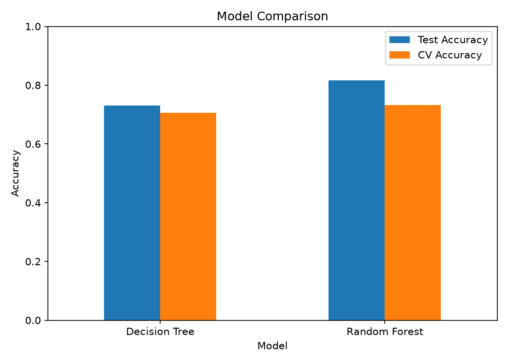
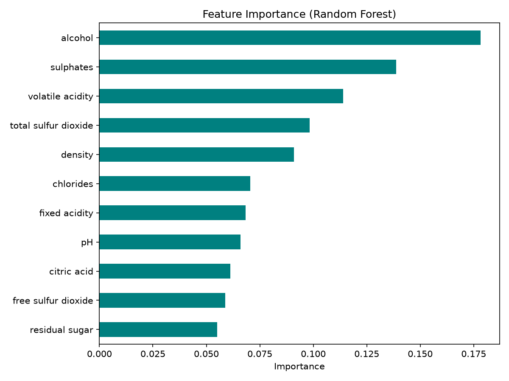
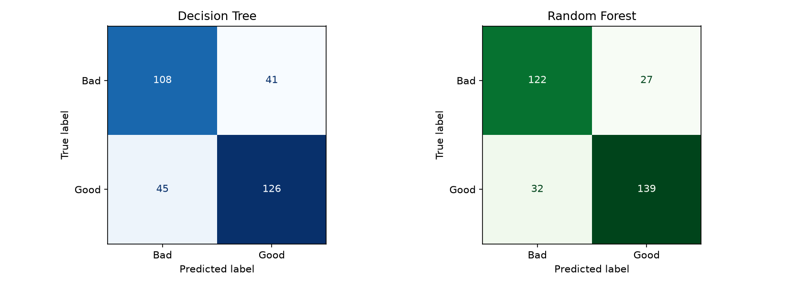

# 🍷 Wine Quality Classification

A machine learning project that predicts whether a red wine is of good or bad quality using Decision Tree and Random Forest classifiers.

## 📌 Overview

This project uses the physicochemical properties of red wine (such as acidity, alcohol, and sulphates) to classify its quality.
The original `quality` score (3 to 8) is converted into a binary target:

- `quality >= 6` → **Good (1)**
- `quality < 6` → **Bad (0)**

## 📂 Dataset

- **Source:** Wine Quality Dataset (UCI Machine Learning Repository / Kaggle)
- **File:** `data/winequality-red.csv`
- **Size:** 1599 rows, 11 input features, 1 target column (`quality`)
- **Features:** fixed acidity, volatile acidity, citric acid, residual sugar, chlorides, free sulfur dioxide, total sulfur dioxide, density, pH, sulphates, alcohol

## ⚙️ Algorithms Used

- **Decision Tree Classifier** (`max_depth=5`)
- **Random Forest Classifier** (`n_estimators=200`)

## 🔄 Project Workflow

1. Load the dataset
2. Exploratory Data Analysis (quality distribution, correlation heatmap)
3. Create the binary target variable
4. Split data into training (80%) and testing (20%) sets
5. Train Decision Tree and Random Forest models
6. Evaluate with accuracy, classification report, confusion matrix, and 5-fold cross-validation
7. Analyze feature importance and compare the models

## 🛠️ Technologies

Python, Pandas, NumPy, Matplotlib, Seaborn, Scikit-learn

## 📁 Project Structure

```
wine-quality-classification/
├── data/
│   └── winequality-red.csv
├── images/
├── wine_quality.py
├── requirements.txt
└── README.md
```

## 🚀 How to Run

```bash
git clone https://github.com/isratsomu/wine-quality-classification.git
cd wine-quality-classification
pip install -r requirements.txt
python wine_quality.py
```

All plots will be saved in the `images/` folder.

## 📊 Results

| Model | Test Accuracy | 5-Fold CV Accuracy |
|-------|---------------|--------------------|
| Decision Tree | XX | XX |
| Random Forest | XX | XX |

### Model Comparison


### Feature Importance (Random Forest)


### Confusion Matrices


## 🔍 Conclusion

Random Forest generally performs better than a single Decision Tree because it combines the predictions of many trees, which reduces overfitting.
Features such as alcohol, volatile acidity, and sulphates play an important role in determining wine quality.

## 👩‍💻 Author

Israt Jahan Sumaiya